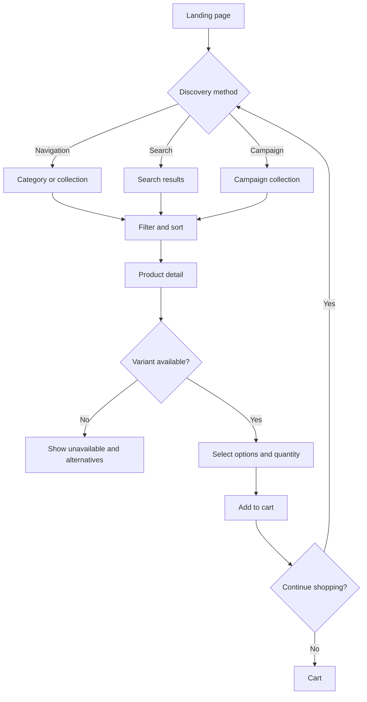
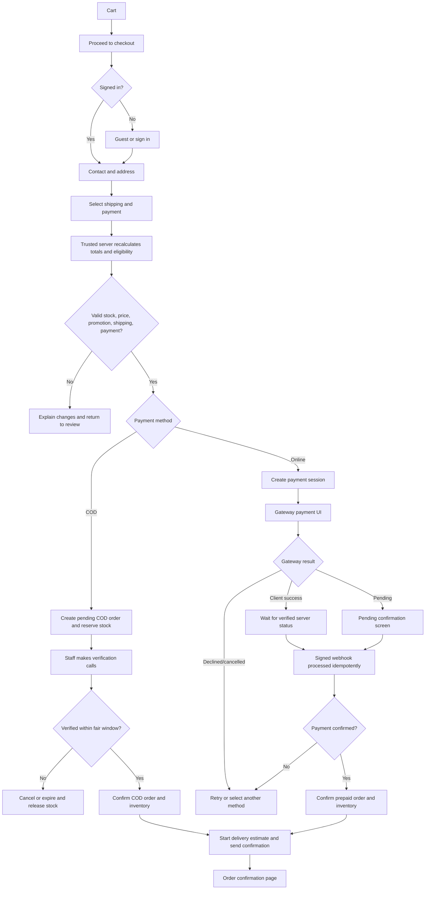
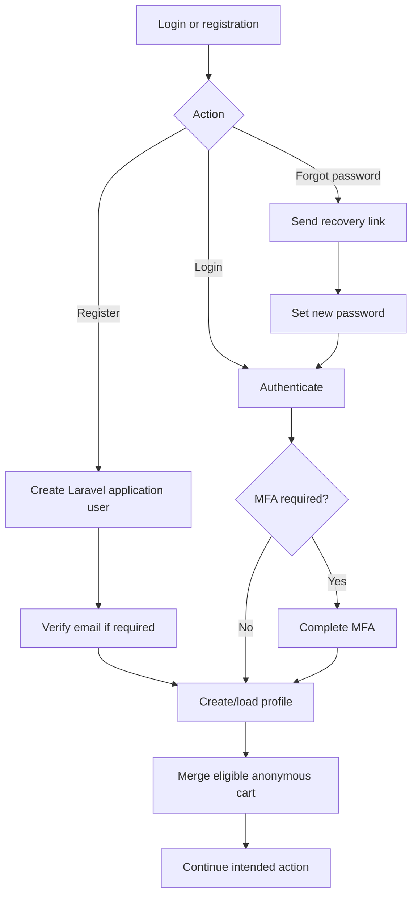
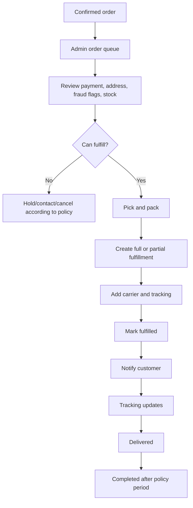
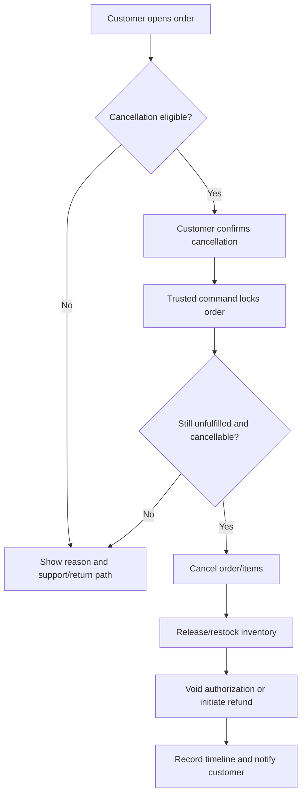
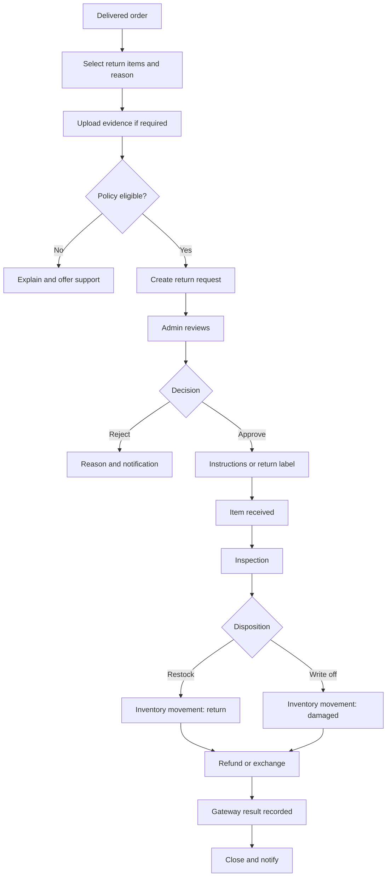
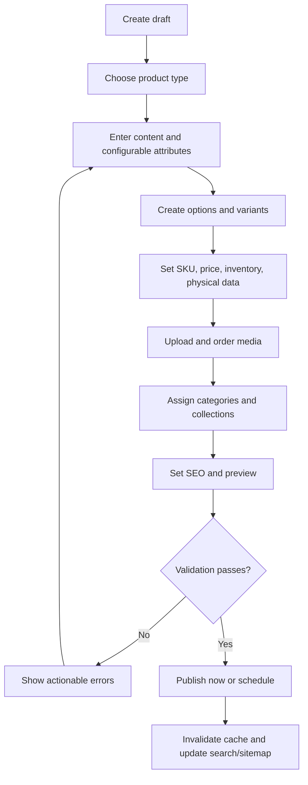
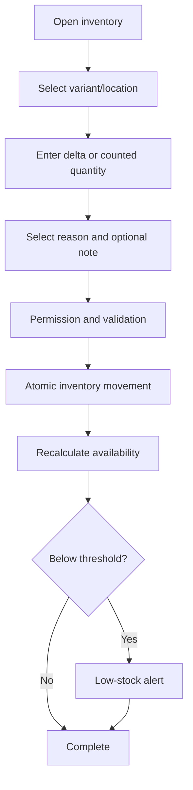
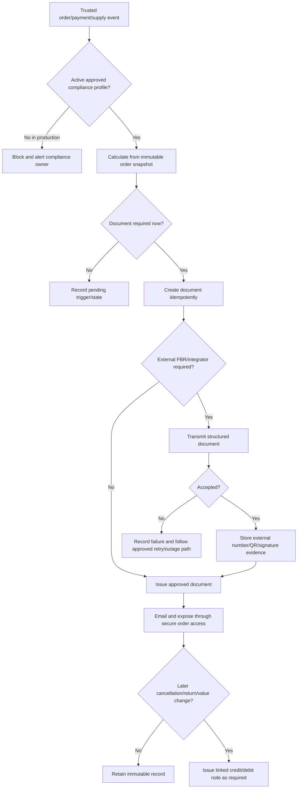

# SoftGlam Application Flows

**Status:** Draft 1

## 1. Application Map

### Storefront

- `/` Home
- `/search` Search results
- `/categories/[slug]` Category
- `/collections/[slug]` Collection/campaign
- `/products/[slug]` Product detail
- `/cart` Cart
- `/checkout` Checkout
- `/checkout/payment` Payment handoff/embedded provider step
- `/order/confirmation/[reference]` Confirmation with protected access
- `/account/*` Profile, addresses, orders, wishlist, reviews, returns
- `/pages/[slug]` About, contact, FAQs, shipping, returns, privacy, terms

### Admin

- `/admin` Business overview
- `/admin/products`, `/categories`, `/collections`, `/inventory`
- `/admin/orders`, `/returns`, `/customers`
- `/admin/discounts`, `/reviews`, `/content`
- `/admin/reports`
- `/admin/settings/*` Business, shipping, tax, payments, notifications, users/roles, integrations, audit

Exact routes may change with framework conventions; the capabilities and access boundaries remain required.

## 2. Customer Discovery Flow

Key behavior:

- Filters are generated from configured product attributes.
- Product URLs remain stable and indexable.
- Add-to-cart rechecks purchasability and gives a clear recovery message if availability changed.

## 3. Checkout and Payment Flow

Rules:

- Launch checkout accepts Karachi, Sindh delivery addresses and applies the approved rate/threshold in `PRD.md` section 1.9.
- Shipping eligibility and price are recalculated by the trusted server before order/payment creation and snapshotted on confirmation.
- The 1–2 business-day target starts after verified online payment or COD confirmation, not initial checkout submission.
- COD is offered only when trusted-server rules permit it; pending verification reserves stock for the fair 24-hour window but is not fulfillable.
- Two documented phone attempts precede eligible COD expiry, and customer-caused failures follow the reviewed escalation policy in `PRD.md` section 1.10.
- Online payment uses the Safepay-hosted redirect for approved Pakistan-issued cards and contractually enabled mobile wallets; SoftGlam handles no card/wallet credentials.
- Online payment reserves stock for 30 minutes. A late success after reservation release enters an inventory/payment exception rather than overselling.
- A browser redirect never directly marks an order paid.
- Duplicate requests/webhooks produce one payment/order effect.
- If cart data changes, customer must review the new final total before payment.
- If manual courier booking later identifies an address exception, staff holds and contacts the customer for an eligible alternative or cancels/refunds without adding a post-checkout surcharge.

## 4. Authentication Flow

Staff login always routes through protected admin authorization. A valid customer session alone grants no admin access.

## 5. Order Fulfillment Flow

Every status change is timestamped and attributed. Partial fulfillment tracks quantities per order item.

## 6. Customer Cancellation Flow

## 7. Return and Refund Flow

Rules:

- Customer cancellation is available for eligible quantities before trusted courier handover/dispatch; packed status alone does not remove eligibility.
- Launch products have no change-of-mind return. Wrong, missing, damaged, defective, expired, leaking, tampered, authenticity, and materially not-as-described issues remain reviewable under `PRD.md` section 1.11.
- Visible delivery issues use 48-hour reporting guidance, without extinguishing latent-defect, warranty, outage, or non-waivable rights.
- An unboxing video is optional, never a mandatory condition of support.
- SoftGlam pays approved return/replacement transport for seller-, product-, packaging-, or courier-attributable issues.
- Exchange is represented as a return/remedy plus a linked replacement order; the original order is not rewritten.
- Prepaid refunds normally return to the original payment method. Collected COD refunds offer bank transfer or supported wallet; store credit is voluntary.
- Refund amount is computed from refundable paid amounts, prior/pending refunds, discounts, shipping/tax policy, and returned quantity—not current catalog price.
- Customer financial remedy and inventory disposition are separate decisions; opened/unsafe beauty is never restocked merely because a refund is approved.

## 8. Admin Product Publishing Flow

Publishing requires at least one sellable variant, valid pricing, required attributes, and required media/content according to business configuration.

## 9. Inventory Adjustment Flow

Balances are never silently overwritten; each adjustment creates a traceable movement.

## 10. Discount Creation and Evaluation Flow

Admin defines discount type, eligibility, products/collections, customer scope, dates, minimums, total/per-customer usage, and combination rules. At cart and checkout:

1. Normalize the supplied code.
2. Find active rule in the checkout currency/timezone.
3. Validate customer, item, minimum, schedule, and usage eligibility.
4. Apply using deterministic priority/combination rules.
5. Revalidate at final checkout and record redemption atomically with the order.

## 11. Support and Exception Flows

- **Payment succeeded but webhook delayed:** show pending state; reconciliation retrieves provider status; never ask customer to pay again without checking.
- **Webhook repeated/out of order:** store provider event ID and process safely; state machine rejects invalid regressions.
- **Stock changed during checkout:** recalculate atomically, release invalid reservation, and return customer to review.
- **Resend/email failed:** the business transaction remains valid; the application-owned notification is queued for bounded retry, visible to staff, and never rerouted through personal email or an unapproved provider.
- **Carrier unavailable:** permit authorized manual rate/tracking workflow if configured.
- **Product unpublished after purchase:** historical order remains readable from immutable snapshots.
- **Admin lacks permission:** deny on server, log relevant attempt, and show a safe access message.
- **No active approved tax profile:** block production checkout; do not guess a rate or issue a document represented as a tax invoice.
- **Tax/invoice configuration changes after order:** retain the confirmed order/document snapshot; apply changes only according to effective-date rules.
- **Invoice integration delayed:** keep an explicit pending/failed transmission state, retry idempotently under the approved outage procedure, and never invent FBR acceptance.
- **Issued invoice requires correction:** create a linked credit/debit note where required; never edit or delete the issued financial document.

## 12. Tax and Invoice Flow

Order acknowledgement, payment receipt, tax invoice, credit/debit note, and refund confirmation are separate records. Payment-intermediary or courier deductions are reconciled against settlements without changing the amount the customer paid.
