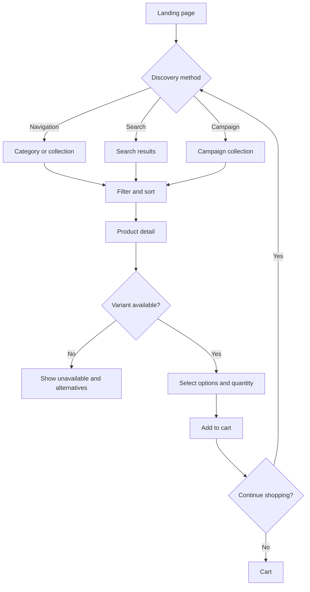
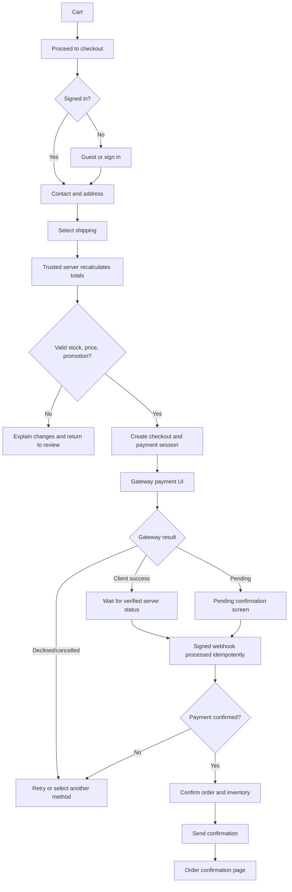
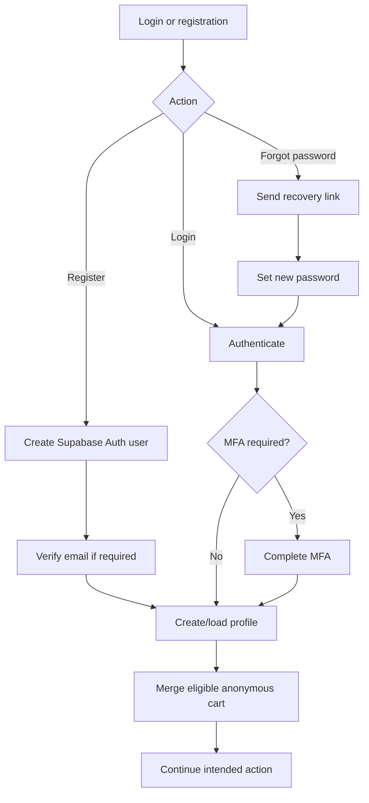
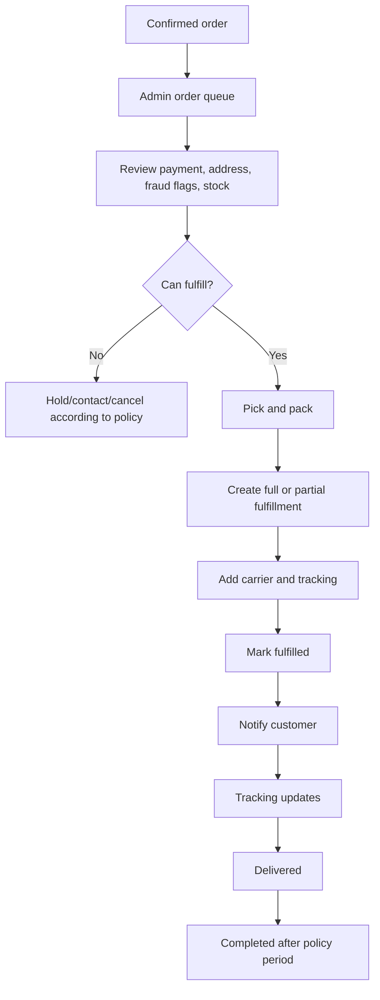
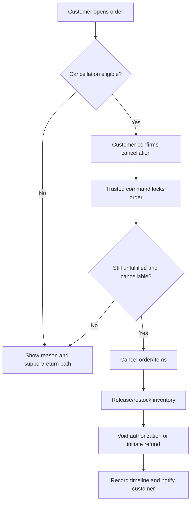
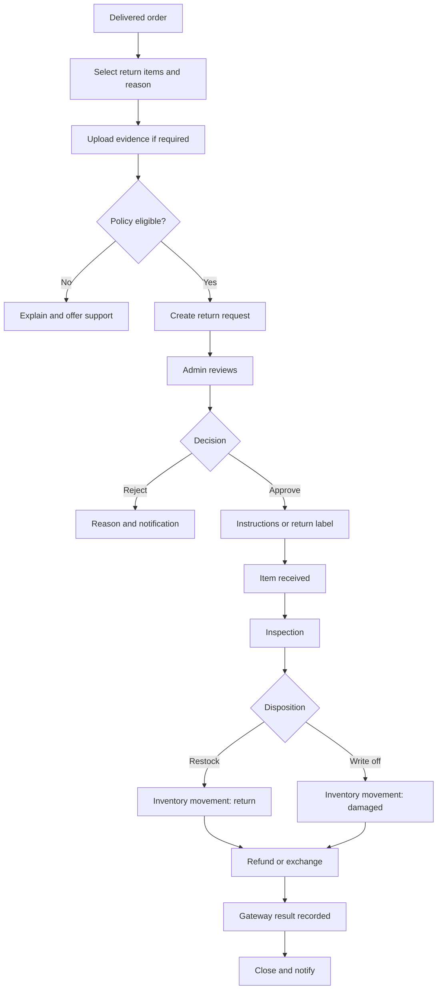
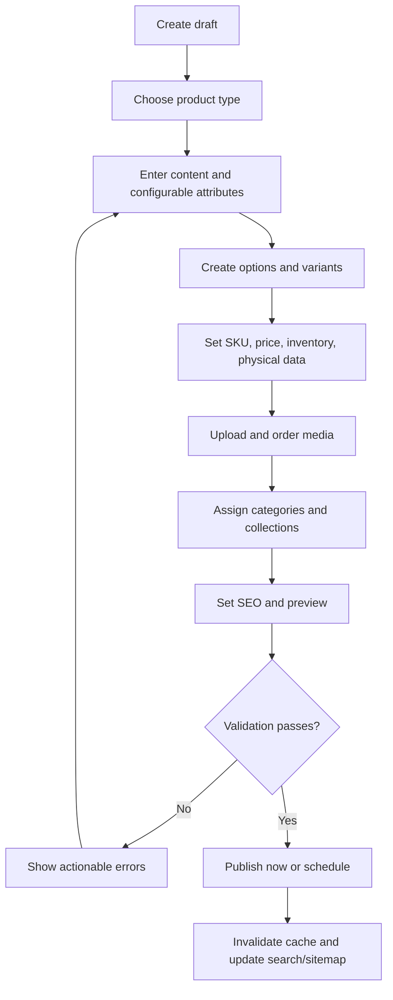
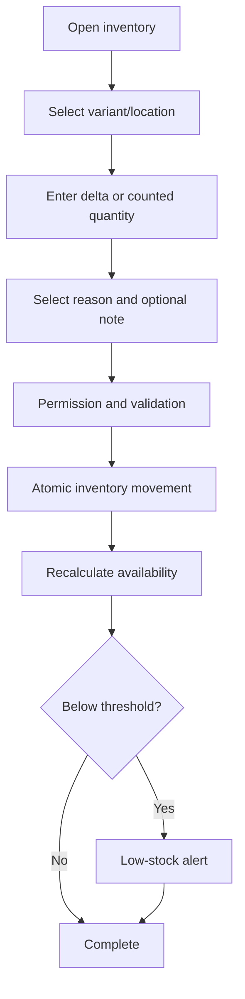

# Softglam Application Flows

**Status:** Draft 1

## 1. Application Map

### Storefront

- `/` Home
- `/search` Search results
- `/categories/[slug]` Category
- `/collections/[slug]` Collection/campaign
- `/products/[slug]` Product detail
- `/cart` Cart
- `/checkout` Checkout
- `/checkout/payment` Payment handoff/embedded provider step
- `/order/confirmation/[reference]` Confirmation with protected access
- `/account/*` Profile, addresses, orders, wishlist, reviews, returns
- `/pages/[slug]` About, contact, FAQs, shipping, returns, privacy, terms

### Admin

- `/admin` Business overview
- `/admin/products`, `/categories`, `/collections`, `/inventory`
- `/admin/orders`, `/returns`, `/customers`
- `/admin/discounts`, `/reviews`, `/content`
- `/admin/reports`
- `/admin/settings/*` Business, shipping, tax, payments, notifications, users/roles, integrations, audit

Exact routes may change with framework conventions; the capabilities and access boundaries remain required.

## 2. Customer Discovery Flow

Key behavior:

- Filters are generated from configured product attributes.
- Product URLs remain stable and indexable.
- Add-to-cart rechecks purchasability and gives a clear recovery message if availability changed.

## 3. Checkout and Payment Flow

Rules:

- A browser redirect never directly marks an order paid.
- Duplicate requests/webhooks produce one payment/order effect.
- If cart data changes, customer must review the new final total before payment.

## 4. Authentication Flow

Staff login always routes through protected admin authorization. A valid customer session alone grants no admin access.

## 5. Order Fulfillment Flow

Every status change is timestamped and attributed. Partial fulfillment tracks quantities per order item.

## 6. Customer Cancellation Flow

## 7. Return and Refund Flow

Refund amount is computed from refundable paid amounts, prior refunds, discounts, shipping/tax policy, and returned quantity—not current catalog price.

## 8. Admin Product Publishing Flow

Publishing requires at least one sellable variant, valid pricing, required attributes, and required media/content according to business configuration.

## 9. Inventory Adjustment Flow

Balances are never silently overwritten; each adjustment creates a traceable movement.

## 10. Discount Creation and Evaluation Flow

Admin defines discount type, eligibility, products/collections, customer scope, dates, minimums, total/per-customer usage, and combination rules. At cart and checkout:

1. Normalize the supplied code.
2. Find active rule in the checkout currency/timezone.
3. Validate customer, item, minimum, schedule, and usage eligibility.
4. Apply using deterministic priority/combination rules.
5. Revalidate at final checkout and record redemption atomically with the order.

## 11. Support and Exception Flows

- **Payment succeeded but webhook delayed:** show pending state; reconciliation retrieves provider status; never ask customer to pay again without checking.
- **Webhook repeated/out of order:** store provider event ID and process safely; state machine rejects invalid regressions.
- **Stock changed during checkout:** recalculate atomically, release invalid reservation, and return customer to review.
- **Email failed:** order remains valid; notification is queued for retry and visible to staff.
- **Carrier unavailable:** permit authorized manual rate/tracking workflow if configured.
- **Product unpublished after purchase:** historical order remains readable from immutable snapshots.
- **Admin lacks permission:** deny on server, log relevant attempt, and show a safe access message.
